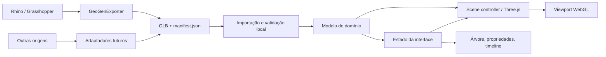

# GeoGenViewer — arquitetura de software

**Revisão:** 0.1 · 25/11/2026 · proposta a validar na implementação

## 1. Produto e limites

Aplicação web independente para consumir, inspecionar e apresentar modelos 3D de arquitetura, fabricação e geometria computacional. O Rhino/Grasshopper continua sendo fonte de produção, mas o contrato deve permitir Blender e outros exportadores. Casa Gerassi é o primeiro caso de estudo: selecionar peças, explicar encaixes e mostrar a ordem construtiva de uma maquete desmontável. Não publicar a geometria sem autorização.

O MVP é um visualizador local, com navegação, hierarquia, seleção e vista explodida. O marco seguinte adiciona montagem e propriedades. Não editar NURBS, certificar estrutura ou substituir o CAD original.

## 2. Fluxo e fronteiras



O modelo de domínio contém IDs, semântica, unidades e passos. O renderer contém recursos GPU e objetos Three.js; o estado da interface contém seleção, visibilidade, modo, câmera e progresso. Evitar guardar meshes no Zustand ou duplicar a geometria a cada frame. Dados de sessão não alteram a geometria de origem.

## 3. Stack proposta e decisões

| Decisão | Escolha | Motivo / alternativa |
|---|---|---|
| Aplicação | Next.js + TypeScript | Compatível com Vercel e experiência existente; Vite SPA seria mais simples se não houvesse rotas e expansão futura |
| Renderização | Three.js + React Three Fiber | Integração React; Three.js puro é referência do CraftBot e alternativa se profiling revelar gargalo |
| Controles | Drei + OrbitControls ou equivalente | Evitar escrever controles de câmera do zero |
| Estado | Zustand | Seleção, filtros, timeline; estado local React para controles simples |
| Validação | JSON Schema 2020-12 + Ajv ou solução equivalente compatível | Contrato independente da linguagem; Zod é alternativa se houver export confiável do schema |
| Formato | GLB + JSON | glTF padronizado para geometria; JSON próprio para semântica, independente do CAD |
| Exportador | Python no Rhino 8 + RhinoCommon | Preservar semântica e medidas de origem; validar API de exportação glTF antes de escolher implementação |
| UI | Tailwind CSS ou CSS modules conforme setup existente | Preferir dependências mínimas e padrões consistentes |
| Testes | Vitest + Playwright | Teste de domínio e smoke test; WebGL em CI pode exigir fallback/ambiente apropriado |
| Hospedagem | Vercel + DNS Cloudflare | Deploy separado do portfólio; sem backend de processamento inicialmente |

Fixar versões compatíveis e Node LTS suportado na inicialização; não escolher versões numéricas sem inspeção. Usar npm inicialmente e um único lockfile. Carregar viewport exclusivamente no cliente (`'use client'`, import dinâmico sem SSR quando necessário). A landing page pode continuar renderizada normalmente.

## 4. Organização de código (proposta)

```text
geogenviewer/
├── AGENTS.md
├── ARCHITECTURE.md
├── ROADMAP.md
├── DATA_SCHEMA.md
├── CRAFTBOT_ANALYSIS.md
├── HANDOFF.md
├── src/
│   ├── app/
│   │   ├── page.tsx
│   │   ├── viewer/page.tsx
│   │   └── demo/page.tsx
│   ├── features/viewer/
│   │   ├── components/       # árvore, toolbar, painéis, timeline
│   │   ├── scene/            # viewport, câmera, picking, transforms
│   │   ├── state/            # seleção, visibilidade, modo
│   │   └── hooks/
│   ├── lib/geogen/
│   │   ├── domain/           # tipos e regras puras
│   │   ├── importers/        # GLB, manifesto, pacote futuro
│   │   ├── validation/
│   │   └── geometry/         # utilitários espaciais e de montagem
│   └── styles/
├── schemas/manifest-v1.schema.json
├── exporters/rhino/         # script e instruções de execução
├── public/demos/             # exclusivamente modelos sintéticos autorizados
├── tests/                    # fixtures sintéticas, testes unitários e e2e
└── package.json
```

Adaptar à árvore existente, sem reorganização gratuita. Rotas: `/` apresenta a ferramenta, `/viewer` abre arquivos locais, `/demo` demonstra com fixture pública sintética. Projetos por slug só depois de um mecanismo de publicação aprovado; URL não listada não é proteção de acesso.

## 5. Pipeline de importação e exportação

1. Usuário seleciona GLB e, opcionalmente, `manifest.json`. O GLB sozinho entra em modo básico; gerar IDs de sessão determinísticos pelo índice do nó, sem afirmar estabilidade entre exportações.
2. Validar bytes/tamanho, versão e estrutura; bloquear recursos remotos embutidos no modo local. Exibir erros acionáveis e cancelar/substituir importações sem condição de corrida.
3. Validar IDs, correspondência de nós, ciclos, unidades e transforms. Verificar o contrato de `DATA_SCHEMA.md`; não adivinhar semântica ausente.
4. Carregar cena com GLTFLoader e construir mapa `elementId → nó(s)`. Capturar transforms de repouso; enquadrar modelo sem alterar escala.
5. Aplicar filtros e overlays sobre a cena de origem; manter picking por componente.
6. Exportador futuro lê documento Rhino sem alterar originais; tessela Breps/NURBS com parâmetros configuráveis e preserva IDs, grupos e propriedades, mede sólidos de origem quando possível e converte eixos/unidades uma única vez. Testar suporte da API Rhino e rota alternativa de escrita GLB. Não depender de UI automatizada sem teste.

## 6. Interação e representação

- Câmera: órbita, zoom, pan, enquadrar tudo/seleção, vistas ortográficas; preservar câmera ao trocar estados no mesmo modelo.
- Seleção: clique/toque, destaque não destrutivo, seleção sincronizada com árvore; ocultar/mostrar/isolar/restaurar. Camadas e grupos são filtros, não necessariamente hierarquia física.
- Vista explodida: offsets no mundo em relação à pose original. Slider 0 retorna à montagem exata; algoritmo determinístico, sem acumular transform. Vetores autorados prevalecem sobre heurística radial. Não prometer movimento sem colisão.
- Montagem: passos explícitos do manifesto, scrub/play/pause, reversível. Não deduzir ordem construtiva de nome de camada. Etapas ausentes = ferramenta indisponível; não inventar dependências.
- Corte: clipping visual em eixos, picking coerente com recorte; tampas e seções CAD exatas ficam para estudo futuro.
- Medições: distância entre pontos na malha é aproximada; propriedades CAD são mostradas com proveniência. Dimensões orientadas não equivalem a AABB; manter unidades da maquete e escala declarada.
- UI desktop: viewport central, árvore à esquerda, propriedades à direita, barra de montagem inferior. Tablet: drawers retráteis, alvos de toque ≥44 CSS px quando prático, modo paisagem e retrato. Celular: um painel por vez, navegação sem impedir zoom/pan. Teclado e redução de movimento.

## 7. Desempenho e segurança

Metas iniciais de teste, não resultados: fixture de 1.000 elementos / até 500 mil triângulos, GLB até 25 MB; buscar ≥30 fps durante órbita em tablet de referência a identificar. Medir tempo até interatividade, p95 de frame, triângulos, draw calls e memória aproximada. Testar também fixture pequena de 20 peças e importações repetidas. Definir novo orçamento após medições reais.

Usar DPR adaptativo, render sob demanda com invalidação durante animações, evitar sombras/postprocessamento pesado em mobile. Instancing ou geometria compartilhada só com mapeamento de seleção preservado; compressão Draco/Meshopt depois de avaliar custo de decode. Não usar `dispose()` em recursos ainda compartilhados; cancelar cargas e revogar URLs temporárias. Oferecer erro para WebGL indisponível ou perdido.

Não executar scripts importados, HTML de metadados ou Python no navegador. Renderizar strings como texto. Limites iniciais configuráveis de 100 MiB para GLB e 10 MiB para manifesto, sujeitos a revisão após testes; não garantir segurança de memória apenas pelo tamanho comprimido. Rejeitar JSON inválido, referências externas, ciclos e extensões obrigatórias não suportadas. Não enviar modelos locais à Vercel, analytics, CDN ou IA. Proteger dados compartilhados por autenticação real quando essa fase for autorizada.

## 7.1 Consolidação V0.9.1

O manifesto e as matrizes de repouso permanecem nas fronteiras de importação e identidade. A organização personalizada guarda chaves de projeto, revisão e binário fora do manifesto. A visibilidade compõe as máscaras individuais, de grupo e de camada aos filtros e ao estado da apresentação.

O renderer mantém um Canvas e decide o caminho de malha por compatibilidade. A alternativa de agrupar geometrias ou materiais apenas por semântica impediria verificar equivalência de atributos, picking e transformações. As malhas repetidas elegíveis compartilham um draw por lote. Transparência, arestas e poses incompatíveis podem manter renderizáveis originais ativos. [Revisão de arquitetura](V091_ARCHITECTURE_REVIEW.md) · [Renderização](V091_RENDERING_SPEC.md)

## 7.2 Sprint A V0.9.12

A importação captura rótulos de origem em `ComponentRecord.identity` e mantém `id` e `sourceObjectId` para as associações. Resolver o rótulo pela mesma função nos workspaces evita que PartIDs duplicados redefinam as chaves de seleção ou contagem. Os extras do GLB e os mapas já permitidos no manifesto são as fontes de PartID. O schema CAD permanece em 1.0.0.

O Resumo usa o motor de Quantitativos e Fabricação da V0.7. A cobertura e a proveniência são computadas pelas mesmas funções dos relatórios. Os subtotais de volume geométrico e de volume informado para fabricação usam valores coletados pelo motor. A extensão do documento de Knolling é opcional e aceita configurações anteriores. Nomes de etapas se associam a IDs ou categorias. A ordem segue a timeline autorada e o agrupamento de peças sem etapa não adiciona dependências.

Maior face usa áreas aproximadas de triângulos coplanares. Eixo principal usa a covariância da superfície tessellada ponderada pela área. Uma caixa orientada global poderia esconder faces dominantes em malhas inclinadas, e determinar uma caixa mínima completa aumentaria o custo em modelos grandes. A orientação usa o mesmo controlador de poses e o layout mede as caixas conservadoras após a rotação.

Os perfis gráficos são aplicados como configuração derivada. Um Canvas adicional ou um compositor permanente aumentaria o custo de memória e competiria com o controle de scissor e as capturas. O rig fornece um adaptador descartável para efeitos e mantém o desenho convencional quando indisponível. [Handoff técnico](DISPLAY_MODES_HANDOFF.md)

## 7.3 Auditoria gráfica V0.9.12

O mesmo Canvas executa o Bayer de Dither e a composição de Clay. GTAO roda apenas nos orçamentos elegíveis, responde à escala do modelo e libera explicitamente os dois materiais omitidos por `GTAOPass.dispose()` no Three.js 0.187.0. O passe de normais dispensa uma segunda atualização de sombras.

A captura de Clay em Desempenho usa a composição para aplicar exposição ao destino offscreen, com escala zero para o GTAO. A captura técnica, o corte ativo e a ausência de suporte a buffers HalfFloat mantêm o caminho convencional. Reservar o compositor a um passe já existente evita introduzir um renderer ou um pipeline de exportação paralelo. [Auditoria](SPRINT_C_RELEASE_AUDIT.md)

## 8. Deploy e DNS

- Repositório GitHub independente, privado inicialmente; Vercel project separado. Preview para branches e produção somente após autorização.
- Adicionar `geogenviewer.fernandobragaportfolio.com.br` em Vercel Settings → Domains. Na Cloudflare criar CNAME `geogenviewer` para destino exato fornecido pelo projeto, DNS only, TTL Auto. Adicionar TXT apenas se solicitado. Não mexer no apex, `www`, nameservers ou registros do portfólio.
- Verificar domínio e certificado HTTPS na Vercel e testar tanto URL `vercel.app` quanto subdomínio. Proxy Cloudflare é opcional e não recomendado inicialmente; se exigido, usar Full (strict), revisar caminhos de validação, regras e caches. Não alterar SSL global sem avaliar portfólio.
- Nenhum banco ou storage pago no MVP. Conferir limites e termos do plano de hospedagem antes de publicar; arquivos locais não consomem upload server-side. Ativos demo publicados são acessíveis a terceiros.

Referências: https://vercel.com/docs/domains/set-up-custom-domain ; https://vercel.com/kb/guide/can-i-use-a-proxy-on-top-of-my-vercel-deployment ; https://registry.khronos.org/glTF/specs/2.0/glTF-2.0.html

## 9. Decisões pendentes

- Auditar APIs e licença de componentes específicos do CraftBot antes de eventual reutilização.
- Verificar export GLB do Rhino 8, precisão em escala de fabricação e desempenho no tablet escolhido.
- Definir convenção de IDs persistentes quando uma peça é substituída; inicialmente usar GUID original + caminho de instância estável quando necessário.
- Aprovar identidade visual, permissões de publicação da IC e critérios quantitativos finais de desempenho.

## 10. Decisões verificadas no bootstrap v0.0/v0.1

- O repositório abrange a raiz com os documentos compartilhados. A aplicação Next existente permaneceu em `geogenviewer/`. O build usa CSS simples e fontes do sistema.
- Next 16.4.6, React 19.3.0, Three.js 0.187.0 e R3F 9.8.2 foram verificados com Node 22.14.0 e npm 10.9.2. O OrbitControls do Three atende à câmera básica sem uma dependência de controles adicional. Estado React local basta até que seleção, árvore e visibilidade precisem de estado compartilhado.
- A especificação glTF 2.0 usa metros e um sistema de mão direita com Y para cima. GLB mantém a cena tessellada e seus transforms. O teste lê `extras.geogenElementId` em `userData` e confirma 0,1 m por eixo no cubo. A versão executável do manifesto e a validação do vínculo entre os arquivos continuam na v0.3. Comparações de fabricação exigem medidas com proveniência.
- GLB, glTF e JSON geométrico próprio foram considerados. GLB embala a geometria em binário e evita o carregamento de arquivos auxiliares na fatia inicial. A especificação GLB admite referências externas, então o importador verifica URIs e bloqueia carregamentos de rede no loader. Draco, Meshopt e Basis obrigatórios exigirão decoders locais avaliados em etapa futura.
- A carga local é assíncrona e a última solicitação prevalece. Um modelo inválido preserva a cena anterior. O viewport renderiza sob demanda com DPR entre 1 e 1,5. A liberação de recursos da cena é responsabilidade do importador. O enquadramento usa limites espaciais e move a câmera, sem modificar o modelo.
- A auditoria do CraftBot sustentou a separação de geometria e semântica, com IDs autorados e ordem explícita. A decisão sobre batching depende de benchmark com cenas equivalentes. A versão atual preserva cada nó e compartilha geometria quando o próprio GLB referencia a mesma malha.

[Especificação glTF 2.0](https://registry.khronos.org/glTF/specs/2.0/glTF-2.0.html)


## 9. Decisões da Sprint 03 (V0.2 e V0.3)

- **Estado de sessão isolado (`zustand` v5.1.0):** `useViewerStore` (`geogenviewer/src/features/viewer/state/viewer-store.ts`) armazena exclusivamente o grafo serializável (`ViewerSceneGraph`) e coleções de IDs (`selectedIds`, `hoveredId`, `hiddenIds`, `isolatedIds`, `expandedIds`, `treeTab`, `searchQuery`, `multiSelectMode`). Nenhuma referência Three.js (`Object3D`, `BufferGeometry`, `Material`) é mantida no store global.
- **Vínculo componente ↔ cena em O(profundidade):** `LoadedScenePackage` (`geogenviewer/src/lib/geogen/importers/package.ts`) mantém `objectByComponentId` e um `WeakMap` mapeando raízes de componente; `resolveComponentId(obj)` sobe a cadeia de pais até o componente proprietário mais próximo, preservando compósitos multi-malha, instâncias compartilhadas e hierarquia aninhada sem varreduras N².
- **Destaque não destrutivo e visibilidade por renderizável:** `SceneController` (`geogenviewer/src/features/viewer/scene/viewport.tsx`) preserva os materiais originais do GLB, cria variantes em cache por cena e restaura/descarta os clones temporários na desmontagem. A visibilidade é aplicada em objetos renderizáveis (`Mesh`, `Line`, `Points`) para que isolar um filho dentro de um pai oculto mantenha o filho visível na cena.
- **Validação estrita GLB + JSON v1.0 (`ajv` v8.20.0):** `parseAndValidateManifest` (`geogenviewer/src/lib/geogen/validation/manifest.ts`) valida schema JSON Draft 2020-12 (`schemas/manifest-v1.schema.json`), SemVer (`1.0`), integridade referencial, ciclos, valores finitos, ausência de HTML/script e consistência física (`isClosed: false` exige `volumeM3: null`), além de verificação opcional de `SHA-256` em `importGlbWithManifestPackage`. Falhas de manifesto bloqueiam o carregamento automático e exigem confirmação explícita do usuário para abrir apenas o GLB em modo básico.
- **Contrato externo para Rhino 8 (`exporter-contract/`):** especificação completa entregue em `exporter-contract/` (`EXPORTER_CONTRACT.md`, `DATA_SCHEMA.md`, `FORMAT_COMPARISON.md`, `manifest.schema.json`, `manifest.example.json`, `model.example.glb`) para desenvolvimento externo do `GeoGenExporter`. Nenhum script Python/Rhino foi adicionado ao repositório Next.js.


## 10. Decisões da Sprint 04 (V0.4 — Vista Explodida)

- **Motor desacoplado (`geogenviewer/src/lib/geogen/explode/controller.ts`):** `ExplodedViewController` captura snapshot imutável das poses locais/mundiais de repouso e pré-computa a inversa 3×3 da matriz linear de cada pai, permitindo aplicar `explosionFactor` monotonicamente sem deriva acumulada nem dupla transformação em hierarquias aninhadas.
- **Convenção CAD explícita (`cadVectorToGltf` / `cadAxisToGltf`):** os eixos apresentados ao usuário seguem o sistema do Rhino (`Z` vertical CAD mapeado internamente para `+Y` no glTF), evitando confusão entre eixos de origem e eixos de renderização.
- **Animação R3F sem spam no Zustand:** transições animadas (`explodeTransition`) avançam via `useFrame` em `SceneController` (`frameloop="demand"` com `invalidate()` por quadro), atualizando slider/leitura numérica do `ExplodePanel` por assinatura direta em memória até o fator final estabilizar.
- **Linhas de referência em lote único:** um único `THREE.LineSegments` com `LineDashedMaterial` e buffer pré-alocado (`raycast = () => {}`) acompanha visibilidade e tema claro/escuro sem criar nós React por componente.


## V0.5 — Câmeras, visibilidade e montagem

### Regiões de renderização

Um Canvas R3F contém uma instância da cena importada. O render manual com prioridade positiva desenha cada região usando viewport e scissor, com câmera e alvo próprios. O raycast usa a câmera e as coordenadas normalizadas da região sob o ponteiro. Single, dual horizontal, dual vertical e quad reaproveitam os mesmos nós e recursos. Quatro Canvases simplificariam os limites dos controles, mas duplicariam contextos WebGL e aumentariam o custo de memória e troca de modelos.

A troca de projeção conserva alvo, orientação e altura aparente no plano que contém o alvo. O enquadramento considera a menor dimensão útil da região. Alvo e altura ortográfica podem ser copiados entre regiões mantendo a direção de cada câmera. Quando seleção ou visibilidade são independentes, a árvore e o inspector acompanham a região ativa e o renderer aplica o escopo de cada região antes do desenho.

O contrato usa `(x, y, z) Rhino → (x, z, -y) Three.js`. Cada direção abaixo aponta do alvo para a câmera.

| Vista | Rhino | Three.js | Eixo visual para cima no Three.js |
|---|---|---|---|
| Superior | +Z | +Y | −Z, equivalente a +Y do Rhino |
| Inferior | −Z | −Y | +Z |
| Frontal | −Y | +Z | +Y |
| Posterior | +Y | −Z | +Y |
| Esquerda | −X | −X | +Y |
| Direita | +X | +X | +Y |
| Axonométrica | +X, −Y, +Z | +X, +Y, +Z | +Y |
| Perspectiva inicial | +X, −Y, +Z com pesos ajustados | +X, +Y, +Z com pesos ajustados | +Y |

### Composição da visibilidade

A abertura semântica inicial oculta os componentes de uma camada marcada como invisível e os das suas subcamadas. O conjunto manual de ocultação pode ser alterado durante a sessão. O renderer combina as permissões de visibilidade do GLB, ocultação manual, interseção com isolamento, filtros e estado da montagem. Cada faceta aceita qualquer opção marcada. Entre facetas, o componente precisa corresponder a todas as facetas ativas. Grupos sobrepostos mantêm a mesma identidade na árvore e no picking.

O isolamento guarda uma cópia das referências do estado anterior de ocultação, seleção de isolamento e filtros. A montagem restringe o conjunto por tempo e preserva os elementos fora da sequência como contexto. A prévia isolada mostra as peças da etapa escolhida. Peças futuras em transparência podem aparecer na cena sem participar do picking. Mostrar tudo limpa as restrições manuais e filtros de sessão. Os estados da montagem permanecem sob controle da timeline.

### Poses, aparência e persistência

O motor de montagem compila a ordem autorada em intervalos cumulativos e usa relógio monotônico na reprodução. O instante determina o estado de cada peça e a fração de seu deslocamento. O controlador converte o vetor mundial por meio da inversa linear da transformação do pai e compõe a posição a partir do repouso. O renderer alterna entre o controlador de explosão e o de montagem ao mudar de workspace. Processar a sequência no renderer com um delta acumulado por frame foi descartado para permitir scrubbing determinístico.

Os modos visuais aplicam variantes de material preservando as referências GLB. As arestas técnicas têm cache por geometria e são descartadas com a cena. O renderer desenha sob demanda e usa limites de DPR conforme a qualidade escolhida. Exportar PNG usa um alvo de renderização temporário na viewport ativa.

As vistas nomeadas persistem câmera, projeção, alvo, altura aparente, visibilidade e exibição no navegador. Combinações de filtros e rascunhos de montagem também usam persistência local. O pacote carregado expõe o manifesto validado e preserva a geometria importada. O editor revalida a sequência com as regras 1.0.0 e preserva os campos de geometria e o hash no download. Persistir preferências no manifesto ligaria configurações do usuário ao exportador e alteraria o contrato.


## V0.6 — Inspeção espacial

O módulo de inspeção em `src/lib/geogen/inspection/` guarda configurações serializáveis, resolve planos ortogonais CAD, calcula medições e valida as referências. O estado de inspeção usa identidade semântica e SHA-256 quando disponível. O manifesto CAD e a malha permanecem fontes distintas do documento de inspeção.

O scene controller aplica os planos shader por passe WebGL e restaura os estados no fim de cada região. O mesmo predicado seleciona o primeiro hit preservado para picking e snap. Contornos e caps CPU usam geometria temporária em cache, que é descartada junto ao contexto de cena. Os materiais de apresentação são reutilizados quando regiões técnicas e sombreadas convivem no quadro.

As medições persistem ponto local, caminho relativo ao componente e ocorrência. A projeção das anotações compartilha as regras da vista ativa com a composição Canvas 2D dos PNGs. A captura técnica tem metadados congelados no instante do render. Named Views V0.5 continuam legíveis e o formato estendido acrescenta estado de inspeção e layout.

[Motor de cortes](V06_SECTION_ENGINE_SPEC.md) · [Motor de medidas](V06_MEASUREMENT_SPEC.md)

## V0.7 — Comparação de revisões e fabricação

A importação gera um snapshot de repouso com identidade de revisão, chave efêmera de importação e índice por componente. Cada revisão conserva seu `LoadedScenePackage`. Dois slots na interface suportam uma coleção futura sem acoplar o domínio a quantidade fixa. IDs CAD são internos ao pacote e a comparação usa pares com lado explícito.

O Canvas e o renderer são compartilhados. Na comparação, uma segunda cena reaproveita os recursos dos pacotes com cópias dos nós renderizáveis. Um estado privado do rig controla câmeras sincronizadas e regiões. Essa opção permite materiais e visibilidade por revisão, preservando as poses de apresentação e o estado anterior. Dois Canvas exigiriam gerenciamento separado de contextos e contadores, além de mais alocações na GPU. Renderizar os objetos originais em duas poses exporia o estado de inspeção e montagem a mutações concorrentes.

A análise ocorre em motores independentes de React. O cache de assinatura e métricas referencia geometrias importadas via `WeakMap`. O diff usa snapshots e lotes cooperativos com cancelamento quando os parâmetros mudam. Os quantitativos produzem registros por ocorrência e os documentos de análise restauram decisões leves por SHA-256, com schemas versionados. A implementação usa as dependências existentes.

[Auditoria V0.7](V07_REVISION_ANALYTICS_AUDIT.md) · [Relatório de implementação](V07_IMPLEMENTATION_REPORT.md)

## V0.8 — Knolling, catálogo e documentação

Os motores de documentação recebem ocorrências de repouso, seu índice de malhas e os resultados V0.7. O layout calcula posições e rotações absolutas em um plano CAD. O runtime aplica matrizes temporárias apenas no modo Knolling e restaura as matrizes locais ao sair. Usar diretamente os offsets da vista explodida foi descartado porque a grade e a orientação mudam o referencial e precisam preservar os filhos.

O catálogo usa virtualização, índice por importação e a mesma seleção semântica do visualizador. Miniaturas e vistas técnicas são renderizadas em fila no renderer da viewport. As geometrias continuam compartilhadas. A composição raster para fichas e callouts usa Canvas 2D. Criar viewports WebGL por card aumentaria o número de contextos e o custo de descarte.

`documentation-v1.schema.json` versiona preferências, callouts e ajustes de layout para os três tipos de exportação. A identidade de documento compara projeto, revisão e SHA-256. Named Views de knolling adicionam o documento auxiliar como extensão opcional; registros V0.5–V0.7 continuam no mesmo domínio de preferência.

[Auditoria V0.8](V08_KNOLLING_CATALOG_AUDIT.md) · [Documentação](V08_DOCUMENTATION_SPEC.md)
