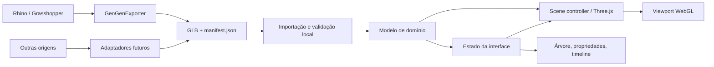

# GeoGenViewer — arquitetura de software

**Revisão:** 0.1 · 25/11/2026 · proposta a validar na implementação

## 1. Produto e limites

Aplicação web independente para consumir, inspecionar e apresentar modelos 3D de arquitetura, fabricação e geometria computacional. O Rhino/Grasshopper continua sendo fonte de produção, mas o contrato deve permitir Blender e outros exportadores. Casa Gerassi é o primeiro caso de estudo: selecionar peças, explicar encaixes e mostrar a ordem construtiva de uma maquete desmontável. Não publicar a geometria sem autorização.

O MVP é um visualizador local, com navegação, hierarquia, seleção e vista explodida. O marco seguinte adiciona montagem e propriedades. Não editar NURBS, certificar estrutura ou substituir o CAD original.

## 2. Fluxo e fronteiras



O modelo de domínio contém IDs, semântica, unidades e passos. O renderer contém recursos GPU e objetos Three.js; o estado da interface contém seleção, visibilidade, modo, câmera e progresso. Evitar guardar meshes no Zustand ou duplicar a geometria a cada frame. Dados de sessão não alteram a geometria de origem.

## 3. Stack proposta e decisões

| Decisão | Escolha | Motivo / alternativa |
|---|---|---|
| Aplicação | Next.js + TypeScript | Compatível com Vercel e experiência existente; Vite SPA seria mais simples se não houvesse rotas e expansão futura |
| Renderização | Three.js + React Three Fiber | Integração React; Three.js puro é referência do CraftBot e alternativa se profiling revelar gargalo |
| Controles | Drei + OrbitControls ou equivalente | Evitar escrever controles de câmera do zero |
| Estado | Zustand | Seleção, filtros, timeline; estado local React para controles simples |
| Validação | JSON Schema 2020-12 + Ajv ou solução equivalente compatível | Contrato independente da linguagem; Zod é alternativa se houver export confiável do schema |
| Formato | GLB + JSON | glTF padronizado para geometria; JSON próprio para semântica, independente do CAD |
| Exportador | Python no Rhino 8 + RhinoCommon | Preservar semântica e medidas de origem; validar API de exportação glTF antes de escolher implementação |
| UI | Tailwind CSS ou CSS modules conforme setup existente | Preferir dependências mínimas e padrões consistentes |
| Testes | Vitest + Playwright | Teste de domínio e smoke test; WebGL em CI pode exigir fallback/ambiente apropriado |
| Hospedagem | Vercel + DNS Cloudflare | Deploy separado do portfólio; sem backend de processamento inicialmente |

Fixar versões compatíveis e Node LTS suportado na inicialização; não escolher versões numéricas sem inspeção. Usar npm inicialmente e um único lockfile. Carregar viewport exclusivamente no cliente (`'use client'`, import dinâmico sem SSR quando necessário). A landing page pode continuar renderizada normalmente.

## 4. Organização de código (proposta)

```text
geogenviewer/
├── AGENTS.md
├── ARCHITECTURE.md
├── ROADMAP.md
├── DATA_SCHEMA.md
├── CRAFTBOT_ANALYSIS.md
├── HANDOFF.md
├── src/
│   ├── app/
│   │   ├── page.tsx
│   │   ├── viewer/page.tsx
│   │   └── demo/page.tsx
│   ├── features/viewer/
│   │   ├── components/       # árvore, toolbar, painéis, timeline
│   │   ├── scene/            # viewport, câmera, picking, transforms
│   │   ├── state/            # seleção, visibilidade, modo
│   │   └── hooks/
│   ├── lib/geogen/
│   │   ├── domain/           # tipos e regras puras
│   │   ├── importers/        # GLB, manifesto, pacote futuro
│   │   ├── validation/
│   │   └── geometry/         # utilitários espaciais e de montagem
│   └── styles/
├── schemas/manifest-v1.schema.json
├── exporters/rhino/         # script e instruções de execução
├── public/demos/             # exclusivamente modelos sintéticos autorizados
├── tests/                    # fixtures sintéticas, testes unitários e e2e
└── package.json
```

Adaptar à árvore existente, sem reorganização gratuita. Rotas: `/` apresenta a ferramenta, `/viewer` abre arquivos locais, `/demo` demonstra com fixture pública sintética. Projetos por slug só depois de um mecanismo de publicação aprovado; URL não listada não é proteção de acesso.

## 5. Pipeline de importação e exportação

1. Usuário seleciona GLB e, opcionalmente, `manifest.json`. O GLB sozinho entra em modo básico; gerar IDs de sessão determinísticos pelo índice do nó, sem afirmar estabilidade entre exportações.
2. Validar bytes/tamanho, versão e estrutura; bloquear recursos remotos embutidos no modo local. Exibir erros acionáveis e cancelar/substituir importações sem condição de corrida.
3. Validar IDs, correspondência de nós, ciclos, unidades e transforms. Verificar o contrato de `DATA_SCHEMA.md`; não adivinhar semântica ausente.
4. Carregar cena com GLTFLoader e construir mapa `elementId → nó(s)`. Capturar transforms de repouso; enquadrar modelo sem alterar escala.
5. Aplicar filtros e overlays sobre a cena de origem; manter picking por componente.
6. Exportador futuro lê documento Rhino sem alterar originais; tessela Breps/NURBS com parâmetros configuráveis e preserva IDs, grupos e propriedades, mede sólidos de origem quando possível e converte eixos/unidades uma única vez. Testar suporte da API Rhino e rota alternativa de escrita GLB. Não depender de UI automatizada sem teste.

## 6. Interação e representação

- Câmera: órbita, zoom, pan, enquadrar tudo/seleção, vistas ortográficas; preservar câmera ao trocar estados no mesmo modelo.
- Seleção: clique/toque, destaque não destrutivo, seleção sincronizada com árvore; ocultar/mostrar/isolar/restaurar. Camadas e grupos são filtros, não necessariamente hierarquia física.
- Vista explodida: offsets no mundo em relação à pose original. Slider 0 retorna à montagem exata; algoritmo determinístico, sem acumular transform. Vetores autorados prevalecem sobre heurística radial. Não prometer movimento sem colisão.
- Montagem: passos explícitos do manifesto, scrub/play/pause, reversível. Não deduzir ordem construtiva de nome de camada. Etapas ausentes = ferramenta indisponível; não inventar dependências.
- Corte: clipping visual em eixos, picking coerente com recorte; tampas e seções CAD exatas ficam para estudo futuro.
- Medições: distância entre pontos na malha é aproximada; propriedades CAD são mostradas com proveniência. Dimensões orientadas não equivalem a AABB; manter unidades da maquete e escala declarada.
- UI desktop: viewport central, árvore à esquerda, propriedades à direita, barra de montagem inferior. Tablet: drawers retráteis, alvos de toque ≥44 CSS px quando prático, modo paisagem e retrato. Celular: um painel por vez, navegação sem impedir zoom/pan. Teclado e redução de movimento.

## 7. Desempenho e segurança

Metas iniciais de teste, não resultados: fixture de 1.000 elementos / até 500 mil triângulos, GLB até 25 MB; buscar ≥30 fps durante órbita em tablet de referência a identificar. Medir tempo até interatividade, p95 de frame, triângulos, draw calls e memória aproximada. Testar também fixture pequena de 20 peças e importações repetidas. Definir novo orçamento após medições reais.

Usar DPR adaptativo, render sob demanda com invalidação durante animações, evitar sombras/postprocessamento pesado em mobile. Instancing ou geometria compartilhada só com mapeamento de seleção preservado; compressão Draco/Meshopt depois de avaliar custo de decode. Não usar `dispose()` em recursos ainda compartilhados; cancelar cargas e revogar URLs temporárias. Oferecer erro para WebGL indisponível ou perdido.

Não executar scripts importados, HTML de metadados ou Python no navegador. Renderizar strings como texto. Limites iniciais configuráveis de 100 MiB para GLB e 10 MiB para manifesto, sujeitos a revisão após testes; não garantir segurança de memória apenas pelo tamanho comprimido. Rejeitar JSON inválido, referências externas, ciclos e extensões obrigatórias não suportadas. Não enviar modelos locais à Vercel, analytics, CDN ou IA. Proteger dados compartilhados por autenticação real quando essa fase for autorizada.

## 8. Deploy e DNS

- Repositório GitHub independente, privado inicialmente; Vercel project separado. Preview para branches e produção somente após autorização.
- Adicionar `geogenviewer.fernandobragaportfolio.com.br` em Vercel Settings → Domains. Na Cloudflare criar CNAME `geogenviewer` para destino exato fornecido pelo projeto, DNS only, TTL Auto. Adicionar TXT apenas se solicitado. Não mexer no apex, `www`, nameservers ou registros do portfólio.
- Verificar domínio e certificado HTTPS na Vercel e testar tanto URL `vercel.app` quanto subdomínio. Proxy Cloudflare é opcional e não recomendado inicialmente; se exigido, usar Full (strict), revisar caminhos de validação, regras e caches. Não alterar SSL global sem avaliar portfólio.
- Nenhum banco ou storage pago no MVP. Conferir limites e termos do plano de hospedagem antes de publicar; arquivos locais não consomem upload server-side. Ativos demo publicados são acessíveis a terceiros.

Referências: https://vercel.com/docs/domains/set-up-custom-domain ; https://vercel.com/kb/guide/can-i-use-a-proxy-on-top-of-my-vercel-deployment ; https://registry.khronos.org/glTF/specs/2.0/glTF-2.0.html

## 9. Decisões pendentes

- Auditar APIs e licença de componentes específicos do CraftBot antes de eventual reutilização.
- Verificar export GLB do Rhino 8, precisão em escala de fabricação e desempenho no tablet escolhido.
- Definir convenção de IDs persistentes quando uma peça é substituída; inicialmente usar GUID original + caminho de instância estável quando necessário.
- Aprovar identidade visual, permissões de publicação da IC e critérios quantitativos finais de desempenho.

## 10. Decisões verificadas no bootstrap v0.0/v0.1

- O repositório abrange a raiz com os documentos compartilhados. A aplicação Next existente permaneceu em `geogenviewer/`. O build usa CSS simples e fontes do sistema.
- Next 16.4.6, React 19.3.0, Three.js 0.187.0 e R3F 9.8.2 foram verificados com Node 22.14.0 e npm 10.9.2. O OrbitControls do Three atende à câmera básica sem uma dependência de controles adicional. Estado React local basta até que seleção, árvore e visibilidade precisem de estado compartilhado.
- A especificação glTF 2.0 usa metros e um sistema de mão direita com Y para cima. GLB mantém a cena tessellada e seus transforms. O teste lê `extras.geogenElementId` em `userData` e confirma 0,1 m por eixo no cubo. A versão executável do manifesto e a validação do vínculo entre os arquivos continuam na v0.3. Comparações de fabricação exigem medidas com proveniência.
- GLB, glTF e JSON geométrico próprio foram considerados. GLB embala a geometria em binário e evita o carregamento de arquivos auxiliares na fatia inicial. A especificação GLB admite referências externas, então o importador verifica URIs e bloqueia carregamentos de rede no loader. Draco, Meshopt e Basis obrigatórios exigirão decoders locais avaliados em etapa futura.
- A carga local é assíncrona e a última solicitação prevalece. Um modelo inválido preserva a cena anterior. O viewport renderiza sob demanda com DPR entre 1 e 1,5. A liberação de recursos da cena é responsabilidade do importador. O enquadramento usa limites espaciais e move a câmera, sem modificar o modelo.
- A auditoria do CraftBot sustentou a separação de geometria e semântica, com IDs autorados e ordem explícita. A decisão sobre batching depende de benchmark com cenas equivalentes. A versão atual preserva cada nó e compartilha geometria quando o próprio GLB referencia a mesma malha.

[Especificação glTF 2.0](https://registry.khronos.org/glTF/specs/2.0/glTF-2.0.html)


## 9. Decisões da Sprint 03 (V0.2 e V0.3)

- **Estado de sessão isolado (`zustand` v5.1.0):** `useViewerStore` (`geogenviewer/src/features/viewer/state/viewer-store.ts`) armazena exclusivamente o grafo serializável (`ViewerSceneGraph`) e coleções de IDs (`selectedIds`, `hoveredId`, `hiddenIds`, `isolatedIds`, `expandedIds`, `treeTab`, `searchQuery`, `multiSelectMode`). Nenhuma referência Three.js (`Object3D`, `BufferGeometry`, `Material`) é mantida no store global.
- **Vínculo componente ↔ cena em O(profundidade):** `LoadedScenePackage` (`geogenviewer/src/lib/geogen/importers/package.ts`) mantém `objectByComponentId` e um `WeakMap` mapeando raízes de componente; `resolveComponentId(obj)` sobe a cadeia de pais até o componente proprietário mais próximo, preservando compósitos multi-malha, instâncias compartilhadas e hierarquia aninhada sem varreduras N².
- **Destaque não destrutivo e visibilidade por renderizável:** `SceneController` (`geogenviewer/src/features/viewer/scene/viewport.tsx`) preserva os materiais originais do GLB, cria variantes em cache por cena e restaura/descarta os clones temporários na desmontagem. A visibilidade é aplicada em objetos renderizáveis (`Mesh`, `Line`, `Points`) para que isolar um filho dentro de um pai oculto mantenha o filho visível na cena.
- **Validação estrita GLB + JSON v1.0 (`ajv` v8.20.0):** `parseAndValidateManifest` (`geogenviewer/src/lib/geogen/validation/manifest.ts`) valida schema JSON Draft 2020-12 (`schemas/manifest-v1.schema.json`), SemVer (`1.0`), integridade referencial, ciclos, valores finitos, ausência de HTML/script e consistência física (`isClosed: false` exige `volumeM3: null`), além de verificação opcional de `SHA-256` em `importGlbWithManifestPackage`. Falhas de manifesto bloqueiam o carregamento automático e exigem confirmação explícita do usuário para abrir apenas o GLB em modo básico.
- **Contrato externo para Rhino 8 (`exporter-contract/`):** especificação completa entregue em `exporter-contract/` (`EXPORTER_CONTRACT.md`, `DATA_SCHEMA.md`, `FORMAT_COMPARISON.md`, `manifest.schema.json`, `manifest.example.json`, `model.example.glb`) para desenvolvimento externo do `GeoGenExporter`. Nenhum script Python/Rhino foi adicionado ao repositório Next.js.
